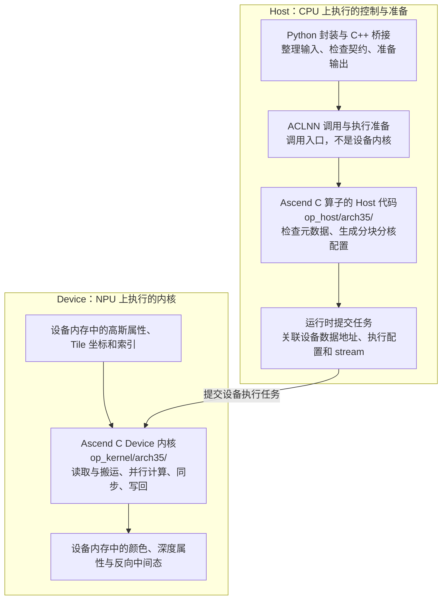
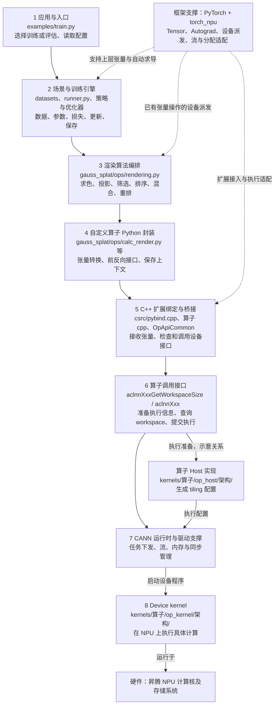

# 3DGS 入门 原理应用与实现

适合第一次接触三维重建、图形渲染和 3D Gaussian Splatting 的读者。阅读后，你应能解释：照片怎样变成可自由观看的三维场景，训练在调整什么，一张新视角图像怎样生成，以及这些步骤在本项目里对应哪些代码。

资料核对日期：2026-11-21。算法介绍以经典静态 3DGS 为起点，工程实例采用本地 `gauss-splat`；动态场景、SLAM、几何重建等扩展单独说明。配套的[算法与算子测试设计](3dgs_testing_guide.md)面向测试工程师。

## 1 从拍摄一个房间开始理解

假设你绕着房间拍了几十到几百张有重叠区域的照片。普通相册只能显示已经拍过的位置；我们希望在电脑里移动“虚拟相机”，看到原来没有拍过的角度。这叫**新视角合成**。

3DGS 用一组可以学习的三维高斯来表达场景。可以把每个高斯想象成一个有颜色、半透明、边缘逐渐变淡的小椭球。很多椭球重叠后，便能从特定视角拼出接近照片的画面。它们在三维空间中有固定位置，所以换一个视角后，会重新投影、重新遮挡，产生新的画面。

这个“小椭球”只是直观比喻：高斯没有实体外壳，贡献从中心向外平滑衰减；工程实现会截去足够微弱的尾部。高斯也不一定是球，可以很扁、很细，贴近墙面、叶片或细小结构。

经典 3DGS 的三个关键部分是：显式高斯表示、优化过程中自适应增删高斯、支持快速正反向计算的可见性感知光栅化。它针对的是已拍摄静态场景的外观重建。[原始论文](https://arxiv.org/abs/2308.04079)

### 1.1 输入和输出是什么

| 阶段 | 输入 | 输出 |
| --- | --- | --- |
| 拍摄与预处理 | 同一场景的多视角照片 | 可用图像、相机标定及稀疏三维点 |
| 训练 | 图像、相机参数、初始点云 | 一组优化后的高斯参数 |
| 渲染 | 已训练高斯、新相机位置与朝向、画面尺寸 | 该视角的图像，可附加某种定义的深度 |

训练通常针对一个具体场景进行优化；更换场景通常需要重新构建该场景的表示。渲染只使用训练得到的表示和相机，不需要再提供目标视角的真实照片。

### 1.2 与常见三维表示比较

| 表示 | 场景如何存储 | 直观特点 |
| --- | --- | --- |
| 点云 | 三维点及颜色等属性 | 便于表达采样位置，单纯点云容易出现空洞 |
| 三角网格 | 顶点、三角面、材质与纹理 | 有明确表面，适合建模、碰撞及传统渲染 |
| 经典 NeRF | 用网络表示空间位置和方向对应的密度、颜色 | 通过沿光线采样合成像素 |
| 3DGS | 高斯中心、形状、不透明度、方向相关颜色 | 通过投影和有序混合生成像素，适于并行加速 |

选型要看画质、几何精度、编辑能力、内存和运行设备。3DGS 的照片级外观不等于已经获得尺寸准确、可直接碰撞的三角网格；“渲染快”也不等于拍摄、标定、训练全程实时。

## 2 3DGS 可以用在哪里

以下场景区分基础能力、应用推演和需要额外算法的能力，避免把所有效果都归给原始 3DGS。

| 方向 | 3DGS 提供的价值 | 实际落地还需要什么 |
| --- | --- | --- |
| 房产、展馆、文物与旅游展示 | 将实景变成可从不同位置观看的内容 | 良好采集覆盖、隐私处理、交互和内容分发 |
| 数字孪生与园区可视化 | 复现环境外观，辅助远程观察 | 坐标配准、尺度校准、资产语义和更新机制 |
| 影视场景与游戏背景 | 从实拍环境获取可漫游背景素材 | 编辑、碰撞几何、光照融合和资产压缩 |
| AR/VR | 在头部移动时生成不同视角 | 双目一致性、低延迟、设备性能与内存预算 |
| 机器人与 SLAM | 作为可渲染地图，参与定位和建图 | 在线相机跟踪、地图更新、几何约束及失效处理 |
| 动态人物或动态场景 | 高斯可作为随时间变化的表达基础 | 时间建模、形变或运动跟踪，不能直接使用静态假设 |

前四项是从新视角合成能力出发的应用方向，并不意味着当前仓库提供完整行业系统。机器人方向有专门的 Gaussian Splatting SLAM 研究，将相机跟踪与地图优化纳入系统；这超出了经典离线 3DGS 的流程。[Gaussian Splatting SLAM](https://arxiv.org/abs/2312.06741)

## 3 一个高斯存了哪些信息

本节公式对应本地协方差、投影与渲染实现的数学模型。第一次阅读可先看“直观含义”。

| 参数 | 符号 | 直观含义 |
| --- | --- | --- |
| 中心 | $\mu=(x,y,z)$ | 椭球放在哪里 |
| 三轴尺度 | $s=(s_x,s_y,s_z)$ | 各方向有多大 |
| 旋转 | 四元数 $q$ | 椭球朝什么方向 |
| 不透明度 | $o$ | 遮挡后面内容的强弱 |
| 球谐系数 | $h$ | 从不同方向看时的颜色变化 |

位置、尺度和旋转一起确定高斯的空间形状。协方差矩阵是这种形状的数学表达：

$$
\Sigma=R(q)\operatorname{diag}(s_x^2,s_y^2,s_z^2)R(q)^T.
$$

尺度取正、四元数按约定归一化后，这种构造能避免随意修改矩阵元素产生非法形状。空间某点 $x$ 的相对影响可写为：

$$
G(x)=\exp\left[-\tfrac12(x-\mu)^T\Sigma^{-1}(x-\mu)\right].
$$

中心处 $G=1$，越远贡献越弱。这里是用于渲染的高斯核，不要求乘上概率密度归一化系数。

训练时常保存 `log_scale` 和 `opacity_logit`，实际使用前转换：

$$s=\exp(\text{log\_scale}),\qquad o=\operatorname{sigmoid}(\text{opacity\_logit}).$$

因此参数值为 0 时，尺度是 1，不透明度是 0.5。把已经激活的尺度再次 `exp`，或把概率再次当作 logit，都会改变场景。当前入口确实执行了这两种激活，见[渲染编排](https://github.com/Atlas-Ascend-Fork/gauss-splat/blob/25c6e337761ad2414a6d3377415681d229fe7a3b/gauss_splat/ops/rendering.py)。

### 3.1 球谐为什么能表达颜色

有些表面从不同方向看，亮度和颜色会变化。球谐函数可以理解为一组定义在方向上的基础函数，将它们按系数相加，就得到该观看方向的颜色：

$$c(d)=\sum_{k=0}^{(L+1)^2-1}h_kY_k(d).$$

$d$ 是单位方向，$L$ 是阶数。零阶只有一个基函数，相当于不随方向变化的颜色；三阶有 16 个基函数，每个 RGB 通道各有 16 个系数。它可以拟合一定程度的方向相关外观，但不是完整的物理材质和光照系统。

当前代码先求单位方向，再计算 SH，随后加 0.5 并将负颜色截到 0；它没有在这一步强制把上界截到 1。方向的正负、SH 系数次序、偏置和截断都属于实现约定。[SH 预处理](https://github.com/Atlas-Ascend-Fork/gauss-splat/blob/25c6e337761ad2414a6d3377415681d229fe7a3b/gauss_splat/ops/sh_preprocess.py)、[球谐封装](https://github.com/Atlas-Ascend-Fork/gauss-splat/blob/25c6e337761ad2414a6d3377415681d229fe7a3b/gauss_splat/ops/spherical_harmonics.py)

## 4 一张图像如何生成

```text
高斯参数与相机
    ↓ 激活尺度与不透明度，按观看方向求颜色
三维高斯
    ↓ 坐标变换与投影
屏幕上的二维椭圆
    ↓ 可见性筛选，建立高斯与屏幕小块的关系
各小块的高斯列表
    ↓ 按深度排序
逐像素从前向后混合
    ↓ 小块拼回图像，裁去填充区域
RGB 与约定的深度输出
```

### 4.1 相机像一个有坐标系的照相机

**外参**决定相机在哪里、朝哪里；**内参**决定焦距和图像主点。将世界坐标变到相机坐标后，针孔模型对 $z>0$ 的点有：

$$u=f_xx/z+c_x,\qquad v=f_yy/z+c_y.$$

其中 $f_x,f_y$ 是以像素计的焦距，$(c_x,c_y)$ 是主点。点越远，投影尺寸一般越小。世界到相机矩阵和相机到世界矩阵互为逆，不能互换使用。外部 gsplat 明确使用 `viewmats` 表示世界到相机；当前高层入口接收 `camtoworlds` 并自行取逆。[gsplat 坐标约定](https://docs.gsplat.studio/main/conventions/data_conventions.html)

### 4.2 将三维形状变成二维椭圆

不仅中心要投影，形状也要投影。设 $R_c$ 为世界到相机的旋转，针孔投影在中心附近的局部变化率为：

$$
J=\begin{bmatrix}f_x/z&0&-f_xx/z^2\\0&f_y/z&-f_yy/z^2\end{bmatrix},\qquad
\Sigma_{2D}=JR_c\Sigma R_c^TJ^T+\epsilon I.
$$

它是局部线性近似，不是对任意大椭球都精确的透视投影。$\epsilon I$ 用于让屏幕上的高斯不至于过小或退化。`conic` 通常存储二维协方差逆矩阵的三个独立元素，方便快速计算每个像素的贡献。

这些数学关系可以在[投影融合封装](https://github.com/Atlas-Ascend-Fork/gauss-splat/blob/25c6e337761ad2414a6d3377415681d229fe7a3b/gauss_splat/ops/projection_three_dims_gaussian_fused.py)及[投影参考测试](https://github.com/Atlas-Ascend-Fork/gauss-splat/blob/25c6e337761ad2414a6d3377415681d229fe7a3b/tests/ops/test_projection_3dgs_forward.py)中对照阅读。

### 4.3 为什么把画面切成 Tile

Tile 是屏幕上的小矩形块。假设一张图有 100 万像素、100 万个高斯，逐像素检查所有高斯会产生约 $10^{12}$ 次候选检查。实际上，一个小高斯只影响少量屏幕区域。

先找出每个高斯覆盖哪些 Tile，再让每个 Tile 只处理有关高斯，可以避免大量无效计算。精确相交筛选进一步排除“包围盒碰到了，但椭圆有效区域没有碰到”的情况。当前项目还会根据每块的工作量做调度，减少某些计算核心很忙、另一些提前结束的现象。相关设计见本地[精确相交资料](https://gitcode.com/cann/cann-recipes-embodied-ai/blob/45d167135c81d97573bfbe0e564bb4a1d9642514/docs/3d_vision/gaussian_splatting/gaussian_splatting_precise_intersection_optimization.md)与[负载均衡资料](https://gitcode.com/cann/cann-recipes-embodied-ai/blob/45d167135c81d97573bfbe0e564bb4a1d9642514/docs/3d_vision/gaussian_splatting/gaussian_splatting_load_balance_optimization.md)。

### 4.4 为什么必须排序

前面的半透明物体会遮住后面的物体，因此混合顺序会影响结果。对像素 $p$，第 $i$ 个高斯贡献的不透明度为：

$$\alpha_i(p)=o_i\exp[-\tfrac12(p-\mu_{2D,i})^T\Sigma_{2D,i}^{-1}(p-\mu_{2D,i})].$$

设高斯已经从近到远排序。到达第 $i$ 个高斯前，剩余的可透过比例为：

$$T_i=\prod_{j<i}(1-\alpha_j),\qquad C(p)=\sum_iT_i\alpha_i c_i+T_{\rm end}c_{\rm bg}.$$

例如黑色背景上，前面是红色高斯、$\alpha=0.5$，后面是蓝色高斯、$\alpha=0.5$。红色贡献为 0.5，蓝色贡献为 $(1-0.5)\times0.5=0.25$，结果是 $(0.5,0,0.25)$。反过来排序得到 $(0.25,0,0.5)$。

按高斯中心深度排序是一种工程近似，并非每条光线上都精确恢复了真实表面的遮挡关系。实际 kernel 还会截断过大 alpha、跳过很小贡献，并在剩余透射率足够小时提前结束。这些规则会影响结果和梯度，必须与具体实现一起理解。[混合封装](https://github.com/Atlas-Ascend-Fork/gauss-splat/blob/25c6e337761ad2414a6d3377415681d229fe7a3b/gauss_splat/ops/calc_render.py)

### 4.5 深度输出不能只看名称

权重记为 $w_i=T_i\alpha_i$，以下是不同的量：

| 名称 | 公式 | 含义 |
| --- | --- | --- |
| 累积深度 | $\sum_iw_i z_i$ | 深度乘上可见贡献后求和 |
| 期望深度 | $\sum_iw_i z_i/\sum_iw_i$ | 对覆盖权重归一化 |
| 累积逆深度 | $\sum_iw_i/z_i$ | 先取倒数再加权 |

单个高斯位于 $z=2$、像素 alpha 为 0.5 时，三个值分别是 1、2、0.25。它们不能直接互换，也不能简单把累积逆深度取倒数就称为期望深度。

外部 gsplat 用 D、ED 区分前两种模式；本地当前 `rendering.py` 将 `1/depths.clamp(min=1e-6)` 送入混合阶段，并未根据模式做上述归一化。因此使用本库深度做测距或监督前，必须先确认语义。[gsplat 深度模式](https://docs.gsplat.studio/main/apis/rasterization.html)

## 5 高斯怎样从照片中学习

### 5.1 初始化

常用流程先用 SfM，也就是“从运动恢复结构”，估计照片的相机位置并得到稀疏点云。点云为高斯提供初始位置，点颜色用于初始化零阶 SH，邻近点距离帮助设置初始尺度。没有稀疏点云时可以设计随机初始化，但效果与收敛条件需另行评估。

当前样例的 `create_splats_with_optimizers` 使用三个近邻距离的平方均值再开方，生成初始尺度；参数随后可以转换为通道优先布局。[初始化源码](https://github.com/Atlas-Ascend-Fork/gauss-splat/blob/25c6e337761ad2414a6d3377415681d229fe7a3b/examples/rasterization/utils.py)

### 5.2 反复执行渲染与纠错

```text
选一张训练照片和相机 → 渲染预测图 → 与照片计算损失
         ↑                                  ↓
更新高斯参数 ← 优化器 ← 反向传播计算各参数的梯度
```

梯度告诉优化器“参数往哪个方向变化能降低当前误差”。移动位置、改变尺度、改变颜色、调整不透明度，都可能让渲染图更接近照片。

本地样例使用 L1 与结构相似性损失的加权组合：

$$\mathcal L=(1-\lambda)\mathcal L_{L1}+\lambda(1-\operatorname{SSIM}).$$

L1 关注像素差；SSIM 关注局部亮度、对比度和结构。损失下降只说明对当前训练目标拟合更好，还需要从没有参与训练的视角验证泛化能力。训练实现见[Runner](https://github.com/Atlas-Ascend-Fork/gauss-splat/blob/25c6e337761ad2414a6d3377415681d229fe7a3b/examples/rasterization/runner.py)。

### 5.3 高斯数量也需要变化

只调整原来那批高斯，有时无法补足细节。因此训练策略会根据梯度、尺寸、不透明度等信息决定增删：

- **复制**：某个小高斯附近需要更多表达能力，增加高斯。
- **分裂**：较大的高斯无法精细表达局部结构，替换为更小的高斯。
- **裁剪**：移除贡献很小或不合适的高斯。
- **不透明度重置**：在特定训练阶段重新调整不透明度，具体频率由策略决定。

增删参数时，优化器中记录的历史动量也要同步更新，否则“编号相同”可能已经指向不同高斯。[gsplat 密度控制文档](https://docs.gsplat.studio/main/apis/strategy.html)

这里的“训练裁剪”会改变模型；渲染时的“可见性筛选”只是当前相机不需要处理某些高斯，两者不是同一件事。

### 5.4 没有神经网络，为什么也能反向传播？

反向传播依赖的是链式法则，不要求模型必须是神经网络。只要知道参数怎样影响输出，以及输出怎样影响损失，就可以计算参数梯度。经典 3DGS 直接优化一个场景的高斯参数；求色、投影、排序和混合是计算阶段，不是多个神经网络模型。COLMAP 通常提前完成相机与稀疏点重建，不在这段可微训练链中。

用一个简化例子理解：假设某像素颜色为 $C=\alpha c$，目标颜色为 $y$，教学用平方损失为 $L=(C-y)^2$，则：

$$\frac{\partial L}{\partial c}=2(C-y)\alpha.$$

当 $\alpha=0.5,c=0.6,y=0.8$，预测是 0.3，颜色梯度是 -0.5。梯度下降会增大颜色值，让预测靠近目标。这个过程只有乘法与求导，也能训练。此例用于解释求导，项目实际使用 L1 与 SSIM，而不是上述平方损失。

[初始化代码](https://github.com/Atlas-Ascend-Fork/gauss-splat/blob/25c6e337761ad2414a6d3377415681d229fe7a3b/examples/rasterization/utils.py) 将 `means`、`scales`、`quats`、`opacities`、`sh` 包装成 `torch.nn.Parameter` 并放入 `ParameterDict`。`Parameter` 表示需要优化的张量，不要求它属于神经网络层。

| 参数 | 更新后的效果 | 存储与渲染的区别 |
| --- | --- | --- |
| `means` | 移动三维中心 | 直接保存坐标 |
| `scales` | 改变椭球大小 | 保存对数尺度，渲染使用 `exp(scales)` |
| `quats` | 改变椭球朝向 | 保存四元数，构造旋转时归一化 |
| `opacities` | 改变不透明度 | 保存 logit，渲染使用 `sigmoid(opacities)` |
| `sh` | 改变不同视角下的颜色 | 球谐系数经过求色得到 RGB |

尺度通过指数函数保持为正，不透明度通过 sigmoid 保持在 0～1。梯度会通过这些变换返回存储参数，例如 $\partial L/\partial s_{log}=(\partial L/\partial s)s$。

### 5.5 从损失到参数更新：代码中的三步

[训练循环](https://github.com/Atlas-Ascend-Fork/gauss-splat/blob/25c6e337761ad2414a6d3377415681d229fe7a3b/examples/rasterization/runner.py) 中的核心逻辑可概括为以下摘录，省略了可选损失与密度控制：

```python
l1loss = F.l1_loss(colors, pixels)
ssimloss = 1.0 - ssim_call(
    colors.permute(0, 3, 1, 2),
    pixels.permute(0, 3, 1, 2),
    window_size=wnd_size,
)
loss = l1loss * (1.0 - cfg.ssim_lambda) + ssimloss * cfg.ssim_lambda
loss.backward()
for optimizer in self.optimizers.values():
    optimizer.step()
    optimizer.zero_grad(set_to_none=True)
```

`colors` 是渲染图，`pixels` 是归一化后的真实照片。默认 `ssim_lambda=0.2`，基础损失是 $0.8L_{L1}+0.2(1-SSIM)$。配置开启时还可能加入深度监督、尺度和不透明度正则等项；不同架构的 SSIM 窗口也不同，比较训练结果时需冻结配置。

- `loss.backward()`：计算梯度，不修改高斯参数值。
- `optimizer.step()`：依据梯度及历史状态修改参数。本项目使用 Adam 系列，并给参数族配置不同学习率。
- `optimizer.zero_grad()`：清除本轮梯度，避免下一轮意外累加。

梯度沿依赖关系反向传递：图像损失 → 像素颜色 → 混合输入的二维中心、形状、颜色和不透明度 → 投影与球谐计算 → 三维高斯参数。一个三维位置可能通过多条路径影响多个像素，各路径的梯度需要相加。不可见点可能没有当前视角的图像梯度。

[CalcRender](https://github.com/Atlas-Ascend-Fork/gauss-splat/blob/25c6e337761ad2414a6d3377415681d229fe7a3b/gauss_splat/ops/calc_render.py) 继承 `torch.autograd.Function`：`forward()` 调 NPU 前向算子并保存反向需要的数据；`backward()` 接收像素梯度，调用 NPU 反向算子，返回各输入的梯度。[投影反向](https://github.com/Atlas-Ascend-Fork/gauss-splat/blob/25c6e337761ad2414a6d3377415681d229fe7a3b/gauss_splat/ops/projection_three_dims_gaussian_fused.py) 继续把梯度传回三维位置、尺度和旋转。PyTorch 不会自动理解任意自定义 NPU 内核，必须提供正确的反向实现。

排序、可见性筛选、阈值截断等离散操作不是处处可微；通常在当前排序与可见性选择下，对连续的渲染计算求梯度。因此不能把“可微渲染”理解成整条流水线的每个操作都连续可微。

### 5.6 复制、拆分和删除的实际规则

以下规则来自本地源码，不代表所有 3DGS 实现。总开关 `densify` 默认关闭；开启后，Runner 在 A5 选择 [ADCStrategy](https://github.com/Atlas-Ascend-Fork/gauss-splat/blob/25c6e337761ad2414a6d3377415681d229fe7a3b/examples/gsplat/strategy/adc.py)，其他架构选择 [DefaultStrategy](https://github.com/Atlas-Ascend-Fork/gauss-splat/blob/25c6e337761ad2414a6d3377415681d229fe7a3b/examples/gsplat/strategy/default.py)。目录中存在其他策略文件，不等于训练入口实际使用它们。

```text
前向渲染 → 损失 → backward
                     ↓
累计可见点的二维中心梯度范数、可见次数、最大屏幕半径
                     ↓
到达策略执行周期：复制 → 拆分 → 裁剪 → 数量上限裁剪
                     ↓
清空累计统计；若到重置周期，再限制不透明度
                     ↓
optimizer.step → 清梯度 → 下一轮
```

策略先将二维中心梯度按图像宽高和相机数缩放，再累计每次可见时的梯度范数，除以可见次数。这里是“先求范数，再平均”，不是把方向不同的梯度先相加再求范数。高梯度是增加表达能力的启发式信号，不是增加点必然改善画质的保证。

默认 A5 ADC 在 `step > 500`、`step < 20000` 且 `step % 100 == 0` 时执行结构调整，因此第一次是代码编号 600，最后一次是 19900。默认不设置重置后的暂停期。

| 操作 | 默认 A5 ADC 触发条件 | 执行内容 |
| --- | --- | --- |
| 复制 | 平均二维梯度 `> 0.0002`，最大实际尺度 `<= 0.01 × scene_scale` | 保留父点，完整复制一个副本；位置不加扰动，净增 1 点 |
| 拆分 | 平均二维梯度 `> 0.0002`，最大实际尺度 `> 0.01 × scene_scale` | 一个父点替换为两个小点，净增 1 点 |
| 低不透明度裁剪 | `sigmoid(opacities) < 0.005` | 永久删除参数及其对应状态 |
| 屏幕尺寸拆分/裁剪 | 指定窗口内半径分别 `> 0.05` / `> 0.15` | 半径除以 `max(W,H)`；`refine_scale2d_stop_iter=0` 默认关闭 |
| 数量上限裁剪 | 上述操作后数量超过 `cap_max`，当前字段默认 600 万 | 删除不透明度最低的超额点 |
| 不透明度重置 | 停止策略前，`step>0` 且每 3000 step | 不透明度取 `min(alpha,0.5)`；重置对应动量，点数不变 |

实际张量操作在 [ops.py](https://github.com/Atlas-Ascend-Fork/gauss-splat/blob/25c6e337761ad2414a6d3377415681d229fe7a3b/examples/gsplat/strategy/ops.py)。拆分子点位置为 $\mu+R\operatorname{diag}(s)\epsilon$，其中 $\epsilon\sim\mathcal N(0,I)$；子点实际尺度为父点的 $s/1.6$，存回 `log(s/1.6)`。默认继承旋转、SH 和不透明度，删除父点。两个随机偏移不要求对称，复制、拆分也不保证渲染结果、体积或不透明度守恒。可选 `revised_opacity=True` 会改变子点不透明度规则，默认关闭。

新复制的点不在同一轮再次拆分。数量上限在增密后执行，因此最终点数达标不代表中间的峰值内存安全。代码注释可能保留历史上限，应以运行配置和字段值为准。

DefaultStrategy 默认在 15000 step 停止、上限 300 万、不透明度重置上限 0.1，默认开启屏幕半径过大裁剪；`step > 3000` 后还删除最大实际尺度超过 `0.1 × scene_scale` 的点。ADC 虽声明 `prune_scale3d`，当前裁剪函数并未使用这条三维尺寸规则。顶层配置中的同名阈值只传给 DefaultStrategy，A5 使用 `cfg.strategy` 的字段，测试和调参时需确认生效对象。

### 5.7 为什么增删点要同步处理优化器？

Adam 为每个参数保存历史动量。增加点时，新点动量初始化为零；删除点时，对应动量必须同时删除；保留点的参数与动量必须始终对应。模型参数、优化器引用、策略统计量和 SH 梯度 hook 都需要一起维护。

当前实现通过新建 `Parameter` 改变张量长度，但没有显式搬运旧 `.grad`。由于结构调整处在 `backward()` 与 `optimizer.step()` 之间，被替换的参数可能跳过本轮更新。这是需要明确验收约定并做回归测试的实现行为，不能假设替换后自动保留梯度。下一轮必须能够正常前向、反向和更新。具体输入、步骤和预期结果见[测试文档第 6.6、7.3 节](3dgs_testing_guide.md)。

## 6 本项目如何实现这些步骤

本章以 `<gauss-splat-checkout>` 当前代码为准，不以早期仓库推断实现。该项目将渲染能力封装为 NPU 加速库，并包含架构分支、自动求导及测试。

| 层级 | 当前位置 | 负责什么 |
| --- | --- | --- |
| 训练入口 | `examples/train.py` | 读取配置，启动训练或评估 |
| 数据 | `examples/datasets/` | COLMAP 数据解析、相机与场景归一化 |
| 训练引擎 | `examples/rasterization/runner.py` | 渲染、损失、反向、优化、评估与保存 |
| 渲染器 | `gauss_splat/ops/rendering.py` | 依次调用求色、投影、筛选、排序和像素混合，将高斯模型渲染成图像 |
| Python 封装层 | `gauss_splat/ops/` | 张量接线、自动求导和上下文管理 |
| C++ 桥接层 | `gauss_splat/csrc/` | 参数检查、输出分配、调用底层接口 |
| Ascend C Host 与设备实现 | `kernels/` | Host tiling 和设备上的计算 |
| 测试 | `tests/host`、`tests/ops`、`tests/kernels` | 主机逻辑、Python 封装及底层接口验证 |

“算子”可理解为流水线中的计算模块，如投影、排序和混合。Python 决定如何连接这些模块，设备 kernel 决定计算怎样分配到硬件执行。算子全部跑通，也不自动证明相机、训练策略和整体画质正确。

当前源码主入口要求 `means=[3,N]`、`quats=[4,N]`、`scales=[3,N]`、`opacities=[N]`、`sh=[K,3,N]`。这与 README 快速示例的 `[N,3]` 和 `sh0/shN` 有差异；首次编写脚本应先看实际入口及测试，不能混用旧示例。

建议阅读顺序：先看本篇的渲染流程，再看 `rendering.py`，接着看 `projection_three_dims_gaussian_fused.py`、`calc_render.py`，最后进入 Host tiling 和设备 kernel。训练策略可从 `examples/gsplat/strategy/` 单独阅读。

### 6.1 为什么同一个算子要分成三层？

Python、C++、Ascend C 通常不是三套重复的算法，而是同一个算子从框架调用到设备执行的不同层。更准确的名称是 Python 封装层、C++ 桥接层，以及 Ascend C 的 Host 配置与设备计算实现。“Ascend C”是昇腾设备算子开发技术，不是“eron C”。

| 层级 | 在本项目中解决的问题 | 这样安排的原因 |
| --- | --- | --- |
| Python 封装 | 组织张量、选择后端、连接 PyTorch 自动求导、保存反向上下文 | 易于修改训练流程和调试张量关系 |
| C++ 桥接 | 接收框架张量、检查契约、准备输出、调用 ACLNN 接口 | 连接 PyTorch 扩展与 NPU 运行时 |
| Ascend C Host tiling | 根据形状和硬件资源决定分块、分核，生成设备执行所需配置 | 把任务分配方案与设备计算衔接起来 |
| Ascend C 设备内核 | 数据搬运、片上存储、并行计算、同步和结果写回 | 针对 NPU 硬件实现高效计算 |

Host tiling 在主机侧执行，不是所有 `kernels/` 目录里的代码都运行在 NPU 上。C++ 本身也不是“只做桥接”的语言；例如本项目的 CPU 调度函数同样可以用 C++ 执行实际计算。分层描述的是职责和执行位置，而不只是文件扩展名。

### 6.2 用当前项目的像素混合算子走一遍调用链

以 A5 的 `clip_lastids` 路径为例，实际调用链是：

```text
rendering.py 组织高斯、Tile 与排序结果
    ↓
calc_render.py：CalcRender.forward
    拼接属性为 gs=[N,10]，调用绑定函数，保存反向中间态
    ↓
CalcRenderClipLastids.cpp：calc_render_fwd_clip_last_ids
    检查输入、分配输出，EXEC_NPU_CMD 调 ACLNN
    ↓
Ascend C Host tiling
    检查形状与类型，准备分核/分块配置
    ↓
Ascend C 设备内核
    读取高斯与像素坐标，执行透明度混合，写回颜色等输出
    ↓
Python 返回张量；后续 backward 使用配套的反向调用链
```

[Python 封装](https://github.com/Atlas-Ascend-Fork/gauss-splat/blob/25c6e337761ad2414a6d3377415681d229fe7a3b/gauss_splat/ops/calc_render.py) 将二维中心、二维形状、不透明度、RGB 和深度属性拼成 `[N,10]`。这里有转置、连续化和 ID 类型转换，这些工作本身不等于像素混合公式。`ctx.save_for_backward` 保存的中间张量会供反向算子使用。

[C++ 桥接](https://github.com/Atlas-Ascend-Fork/gauss-splat/blob/25c6e337761ad2414a6d3377415681d229fe7a3b/gauss_splat/csrc/CalcRenderClipLastids.cpp) 检查设备、dtype、连续性和形状，分配颜色 `[3,T,P]`、深度 `[T,P]` 等输出，再调用 `aclnnCalcRenderFwdClipLastids`。桥接层负责接好输入输出，不是 Python 调用之后就完全不需要它。

[Host tiling](https://github.com/Atlas-Ascend-Fork/gauss-splat/blob/25c6e337761ad2414a6d3377415681d229fe7a3b/kernels/calc_render_fwd_clip_last_ids/op_host/arch35/calc_render_fwd_clip_last_ids_tiling.cpp) 与[设备实现](https://github.com/Atlas-Ascend-Fork/gauss-splat/blob/25c6e337761ad2414a6d3377415681d229fe7a3b/kernels/calc_render_fwd_clip_last_ids/op_kernel/arch35/calc_render_fwd_clip_last_ids_apt.cpp) 再把任务落到硬件上。本路径 Host 要求 `P=1024`，即 32×32 像素的 Tile；C++ 检查写的是 `1<=P<=1024`，因此“通过桥接检查”不代表后续层必然支持。完整接口的有效范围必须结合整条调用链判断。这也是分层测试需要检查契约一致性的具体例子。

### 6.3 能不能全部用同一种语言？

可以尽量统一上层表达，但仍需区分“代码写成什么语言”与“计算在哪里执行”。

```python
scales = torch.exp(log_scales)
opacities = torch.sigmoid(opacity_logits)
```

这两行写在 Python 中；张量位于 NPU 时，实际张量运算由底层设备实现执行，而不是 Python 解释器逐个计算高斯点。用 PyTorch 已有操作组合整个算法适合原型和参考实现，但可能产生大量小算子调用、中间张量和内存读写。自定义或融合内核有机会降低这些开销，是否更快仍需测量。

使用 C++ 编写数据处理与训练流程也是可行的，但实验配置、损失修改和调试成本通常更高；NPU 计算仍需设备实现。Ascend C 主要服务于设备算子，不适合包办照片读取、数据集管理和整个训练应用。即使主机与设备采用相近的 C++ 语法，二者的编译目标、内存空间与执行职责也不相同。

因此当前分层是在开发效率、框架接入和设备性能之间分工，不是算法必须采用三种不同语言，也不是每个算子都必须有完全相同的封装层数。

### 6.4 分层怎样帮助测试和定位？

| 现象或问题 | 优先检查的证据 |
| --- | --- |
| 相机、布局或梯度返回顺序错误 | Python 调用前后的张量与 Autograd 接口 |
| dtype、设备、形状错误，或输出分配不匹配 | C++ 入口检查、分配和 ACLNN 实参 |
| 只在特定大小、尾块或核数下错误 | Host tiling、设备覆盖范围、搬运与同步 |
| 前向正常但训练失败 | 从像素梯度逐层检查反向、保存中间态和参数梯度 |

这些只是定位入口，不能仅凭症状认定责任层。可靠做法是固定同一份输入，逐层保存实际张量，与独立数学参考比较，找到第一个出现差异的边界。桥接或底层接口的直接调用可用于隔离上层封装，但不能代替上层集成测试。详细检查表与定位步骤见[测试文档第 2.4—2.6 节](3dgs_testing_guide.md)。

### 6.5 Host / Device 执行位置与实际目录对应图

Host 指主机 CPU 一侧，Device 在本项目中指昇腾 NPU 一侧。**Ascend C 算子工程同时有 Host 代码和 Device 内核；与 NPU 计算有关，不等于代码自身在 NPU 上运行。** 下图以当前 A5 像素混合算子为例，显示职责与任务流，不代表运行时内部每个函数的严格调用时序。



实际目录如下，名称大小写以仓库为准，是 `kernels/`、`op_host/` 和 `op_kernel/`：

```text
<gauss-splat-checkout>/
└── kernels/
    └── calc_render_fwd_clip_last_ids/
        ├── op_host/
        │   └── arch35/
        │       └── calc_render_fwd_clip_last_ids_tiling.cpp
        │           → CPU：检查形状等元数据，生成执行配置
        └── op_kernel/
            └── arch35/
                ├── calc_render_fwd_clip_last_ids_apt.cpp
                │   → NPU：组织设备内搬运、计算、同步和写回
                └── fwd_simt_vf.h
                    → NPU：像素级计算实现的一部分
```

这里的“读取数据、写回输出”主要指访问 **NPU 设备内存**。输入通常已经放在设备上，输出也通常继续留在设备上供下一算子使用，并不是每个内核都重新从 CPU 传入、再将结果传回 CPU。内核还可能在设备全局内存与片上缓冲之间搬运数据，这是 NPU 内部搬运。

同样，Python 在 CPU 上发起 `torch.exp(x)`，不表示指数运算也在 CPU 上完成：若 x 在 NPU 上，张量运算交给设备实现。Host 持有的张量对象及 shape、dtype 等元数据，与 Device 存储的数据本体要分开理解。

图中设备内核由编译后的程序执行，不是在 NPU 上解释 `.cpp` 源文件。Host 与 Device 源文件可能都采用 C++ 风格，但编译目标和执行位置不同。文件路径对应的详细实现见[Host tiling](https://github.com/Atlas-Ascend-Fork/gauss-splat/blob/25c6e337761ad2414a6d3377415681d229fe7a3b/kernels/calc_render_fwd_clip_last_ids/op_host/arch35/calc_render_fwd_clip_last_ids_tiling.cpp)、[内核编排](https://github.com/Atlas-Ascend-Fork/gauss-splat/blob/25c6e337761ad2414a6d3377415681d229fe7a3b/kernels/calc_render_fwd_clip_last_ids/op_kernel/arch35/calc_render_fwd_clip_last_ids_apt.cpp)和[像素计算](https://github.com/Atlas-Ascend-Fork/gauss-splat/blob/25c6e337761ad2414a6d3377415681d229fe7a3b/kernels/calc_render_fwd_clip_last_ids/op_kernel/arch35/fwd_simt_vf.h)。

### 6.6 从应用到运行时与设备内核的完整实现分层

下面按“谁发起需求、谁组织算法、谁提供执行接口、谁实际计算”展开当前仓库。**运行时不等于 kernel，也不是一个排在 kernel 之后的数学步骤：运行时负责组织任务执行，kernel 是被执行的计算程序。** 驱动和硬件是执行支撑，CANN、torch_npu 等是外部依赖，并非本仓库自行实现。



实线表示这条自定义算子路径的主要调用/执行关系，虚线表示框架支撑；这不是要求每项运算都逐层调用所有框。已有 PyTorch 张量运算通过 torch_npu 的设备派发进入其后端，不一定经过本仓库的 C++ 桥接；调用底层 ACLNN 测试也可以绕过 Python。图中 Host tiling 属于算子实现的一部分，运行时与算子执行准备如何组织它，不应仅凭图推断精确内部调用栈。

| 层级 | 当前目录或接口 | 主要输入 → 输出 | 核心功能与执行位置 |
| --- | --- | --- | --- |
| 应用与入口 | `examples/train.py`、`examples/rasterization/config.py` | 配置、数据路径、checkpoint → 训练或评估任务 | Host 选择流程和运行参数 |
| 数据与训练引擎 | `examples/datasets/`、`examples/rasterization/runner.py`、`utils.py`、`examples/gsplat/strategy/` | 照片、相机、场景参数 → loss、更新后模型、评估结果 | Host 编排；张量计算可下发 NPU；训练含反向与更新，推理不含这两步 |
| 渲染算法编排 | `gauss_splat/ops/rendering.py` | 高斯参数、相机、图像大小 → 渲染图及辅助信息 | Host 连接各阶段，具体张量计算由相应后端执行 |
| Python 算子封装 | `gauss_splat/ops/calc_render.py` 等 | 上层张量 → 底层实参、返回张量及梯度 | Host 组织接口与 Autograd 上下文；其张量操作可以在设备执行 |
| 框架支撑 | 外部 `torch`、`torch_npu` | Tensor 操作、计算图 → 后端调用与梯度调度 | 支撑多层，不是独立的 3DGS 数学阶段 |
| C++ 绑定与桥接 | `gauss_splat/csrc/pybind.cpp`、`CalcRenderClipLastids.cpp`、`OpApiCommon.h/.cpp` | 框架张量 → ACLNN 实参和输出张量 | Host 绑定、契约检查、分配与调用；初始化设备张量可能触发设备操作 |
| ACLNN 算子接口 | 例如 `aclnnCalcRenderFwdClipLastids` | 输入/输出描述、执行配置、工作空间与流 → 已提交的算子任务 | Host 调用入口；不是新语言，不等于数学内核 |
| Host tiling | `kernels/<op>/op_host/<arch>/` | 张量元数据、硬件能力 → 分核分块配置 | CPU 执行，服务于 NPU 计算 |
| 运行时与驱动 | 外部 CANN 与配套驱动 | 执行任务与设备资源 → 调度、启动与完成管理 | 执行支撑；不是本仓库里的另一个渲染算法 |
| Device 内核 | `kernels/<op>/op_kernel/<arch>/` | 设备输入数据、tiling 配置 → 设备输出与中间态 | NPU 执行搬运、计算、同步、写回 |

以本项目像素混合为例，Python 名称 `CalcRender`、C++ 名称 `calc_render_fwd_clip_last_ids`、接口名称 `aclnnCalcRenderFwdClipLastids` 与 `op_kernel` 里的实现指向同一条能力链，不能按名字数量统计成多个模型或多套独立算法。

ACLNN 的两段式调用可在[当前仓库的底层测试](https://github.com/Atlas-Ascend-Fork/gauss-splat/blob/25c6e337761ad2414a6d3377415681d229fe7a3b/tests/kernels/test_calc_render_fwd_clip_last_ids.cpp)看到：先调用 `GetWorkspaceSize` 获取工作空间需求和 executor，按需要申请空间，再调用执行接口；测试随后使用 `aclrtSynchronizeStream` 等待设备任务完成。函数提交返回不等于所有设备计算已经完成，输出的数据通常仍在设备内存中。

阅读时可以沿这个问题链逐层确认：**谁调用它？传入什么？代码自身在哪里运行？数值计算在哪里发生？输出交给谁？** 层间职责可以调整，例如把属性拼接从 Python 移到 C++，但张量契约、执行位置、自动求导和生命周期必须仍然正确。

## 7 怎样判断结果好不好

| 观察对象 | 关注点 |
| --- | --- |
| 静态图像 | 文字是否清晰，细杆是否断裂，是否有漂浮物、空洞或模糊 |
| 连续移动视角 | 是否闪烁、突然跳变、边缘抖动、遮挡关系变化异常 |
| 保留测试视角 | 对没有用于训练的视角是否仍然正确 |
| 深度与几何 | 是否符合对应定义，是否与真实尺度或传感器一致 |
| 资源与速度 | 完整一帧多快，首帧多慢，显存或设备内存是否可接受 |

PSNR 越高通常表示像素误差越小；SSIM 越高通常表示局部结构更相似；LPIPS 越低通常表示感知距离更小。比较前必须统一图像范围、尺寸、裁剪方式及指标配置。平均分不能掩盖单个视角的严重错误。

## 8 常见误解和能力边界

- **不是把照片贴在很多小球上。** 颜色和形状是经过优化的连续参数。
- **高斯不需要都是球。** 各向异性椭球能表达更丰富的局部结构。
- **看起来真实不代表几何精确。** 测量、碰撞、机器人规划要补充几何验证。
- **静态方法不会自动处理运动。** 运动物体、曝光变化、反光和拍摄盲区可能造成重影或错误表示。
- **低训练损失不等于所有视角都好。** 训练视角覆盖不足时，未观察区域没有可靠证据。
- **实时渲染不是实时训练。** 还要考虑数据、优化、内存及内容加载。
- **优化可能改变结果。** 过滤阈值、早停、低精度和排序近似需要测试。

Mip-Splatting 研究了改变焦距或相机距离时的采样伪影，说明缩放与多尺度观察本身就是重要测试场景。[作者项目页](https://niujinshuchong.github.io/mip-splatting/)

2DGS 使用空间中的有方向二维高斯圆盘来改善表面表达。这里的“二维”指基元，不是只生成二维照片；也不能把 2DGS 与本项目的三维高斯投影步骤混为一谈。[2DGS 作者项目页](https://surfsplatting.github.io/)

FlashGS 从算法与底层实现两方面减少冗余计算、改善流水和调度。本地有相关优化思想，但其论文中的 CUDA 测速不能作为本地 NPU 的性能结论。[FlashGS 作者项目页](https://maxwellf1.github.io/flashgs_page/)

## 9 继续学习与自测

建议依次完成：解释一个高斯的五类参数；手算两个半透明高斯的颜色；画出投影、筛选、排序、混合流程；区分训练与渲染；阅读本地一次 forward 和 backward 的调用链。

四个自测问题：

1. 将相机拉远，屏幕上的高斯一般变大还是变小？为什么？
2. 为什么只验证排序后的深度，不验证高斯 ID，仍可能漏掉错误？
3. 不透明度 0.5、深度 2 的单高斯，累积深度和期望深度分别是多少？
4. 为什么一个算子的前向结果正确，训练仍可能失败？

答案：一般变小，因为透视比例与深度有关；深度正确不保证颜色等属性取自正确高斯；分别是 1 与 2；反向梯度、优化器状态、配置或训练策略仍可能错误。

推荐资料：

| 资料 | 用途 |
| --- | --- |
| [3DGS 原论文](https://arxiv.org/abs/2308.04079) | 理解方法总体设计 |
| [Graphdeco 官方实现](https://github.com/graphdeco-inria/gaussian-splatting) | 参考实现；使用时固定提交，当前主分支包含后续扩展 |
| [gsplat 知识库](https://docs.gsplat.studio/main/) | 查接口、坐标约定、训练策略与测试方法 |
| [本地训练推理流程资料](https://gitcode.com/cann/cann-recipes-embodied-ai/blob/45d167135c81d97573bfbe0e564bb4a1d9642514/docs/3d_vision/gaussian_splatting/gaussian_splatting_training_inference_flow.md) | 进一步阅读历史实现，注意与当前版本对照 |
| [本地 Python API](https://github.com/Atlas-Ascend-Fork/gauss-splat/blob/25c6e337761ad2414a6d3377415681d229fe7a3b/docs/zh/gauss_splat_api.md) | 查项目接口，并与当前源码核对 |
| [本篇配套测试设计](3dgs_testing_guide.md) | 将数学理解转化为可执行测试计划 |
